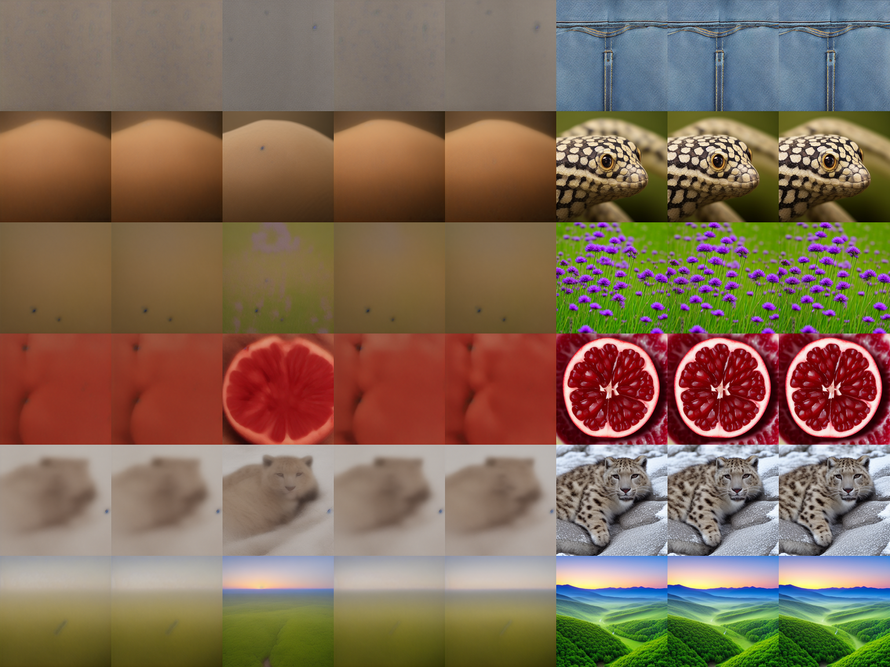

# Anatomy of Acceleration Adapters

Where does few-step ability live inside a distilled diffusion model? Few-step distillation
is often shipped as a low-rank weight delta on a base model, such as LCM-LoRA. This repo
takes those deltas apart in weight space.

It is a term project for Generative Models for Multimedia at METU. The proposal is in
[`research_ideas/proposal.md`](research_ideas/proposal.md).

## Current direction

**Status: one pilot done, replication not started.**

The pilot dissected LCM-LoRA for Stable Diffusion 1.5 (278 modules, rank 64) at 4 steps on
16 prompts. "Recovery" is how much of the full adapter's effect a part reproduces, measured
by LPIPS distance to the full adapter's same-seed image.

| Part of the adapter kept | Recovery |
|---|---:|
| Full adapter, rank 64 | 1.00 |
| Rank 8 | 0.98 |
| **Rank 4** | **0.96** |
| Decoder (up) blocks only | 0.75 |
| Encoder (down) blocks only | 0.01 |
| Time-embedding projections only | 0.00 |

- **The adapter is effectively rank 4 or lower.** The median module needs 2 singular
  directions for 90% of its energy.
- **The decoder carries it.** Up blocks hold 82% of the adapter's energy.
- **The time-conditioning path is nearly idle.** Removing it costs 6% of the effect.



*Columns: no adapter, time layers only, convolutions only, self-attention only,
cross-attention only, rank 4, rank 16, full adapter.*

This is one adapter, 16 prompts and a closeness metric, not image quality. The next step is
to repeat it on Hyper-SD, TCD and DMD2 adapters, with a go/no-go decision on 1 December 2026.

| Read | For |
|---|---|
| [`research_ideas/proposal.md`](research_ideas/proposal.md) | Questions, hypotheses, plan and timeline |
| [`research_ideas/study-guide.md`](research_ideas/study-guide.md) | Background and reading list |
| [`research_ideas/pilots.md`](research_ideas/pilots.md) | How the pilots were run |

## Reproduce

Tested on an Apple M4 Pro with 24 GB, on MPS at batch size 1.

```bash
python3.13 -m venv .venv && .venv/bin/pip install -e '.[dev]'
.venv/bin/pytest

.venv/bin/python scripts/pilots/c_lora_anatomy.py
```

The script needs Stable Diffusion 1.5 and downloads the 135 MB LCM-LoRA file on first use.
It writes `results/pilots/c_lora_anatomy.json` and the image above.

## Layout

```
research_ideas/              Proposal, study guide and pilot notes
scripts/pilots/              Pilot experiments, including the adapter dissection
results/pilots/              Raw pilot outputs
src/wspd/metrics.py          LPIPS, CLIP and spectral metrics
src/wspd/lab.py              Sampler-level interventions used by the other pilots
docs/EXPERIMENT_1.md         The project's earlier experiment, kept as a record
runs/                        Caches and generated images (gitignored)
```

## Earlier work

The repo began with a different experiment, on LLM-driven weight editing. Its write-up,
code and results are kept in [`docs/EXPERIMENT_1.md`](docs/EXPERIMENT_1.md).
