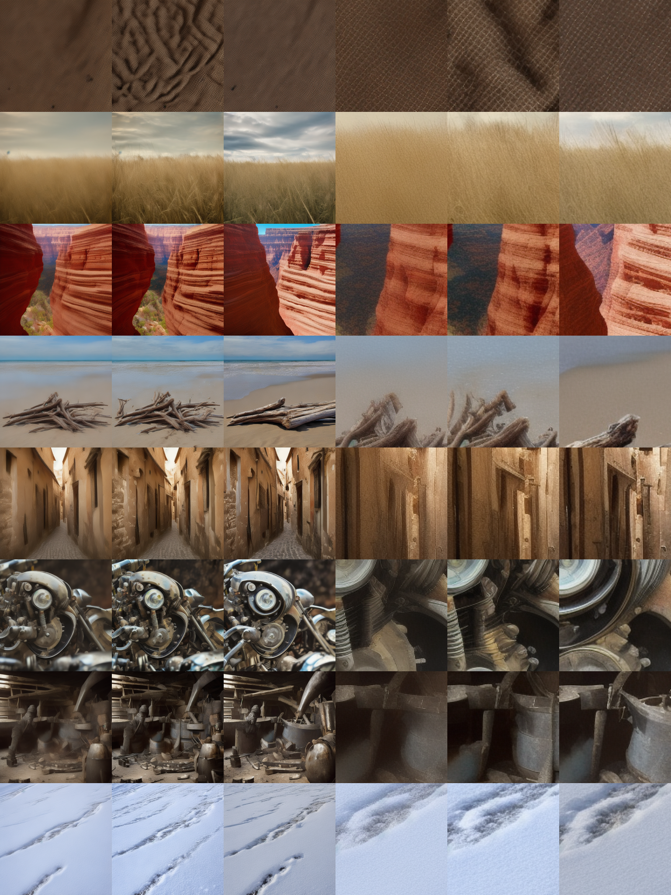
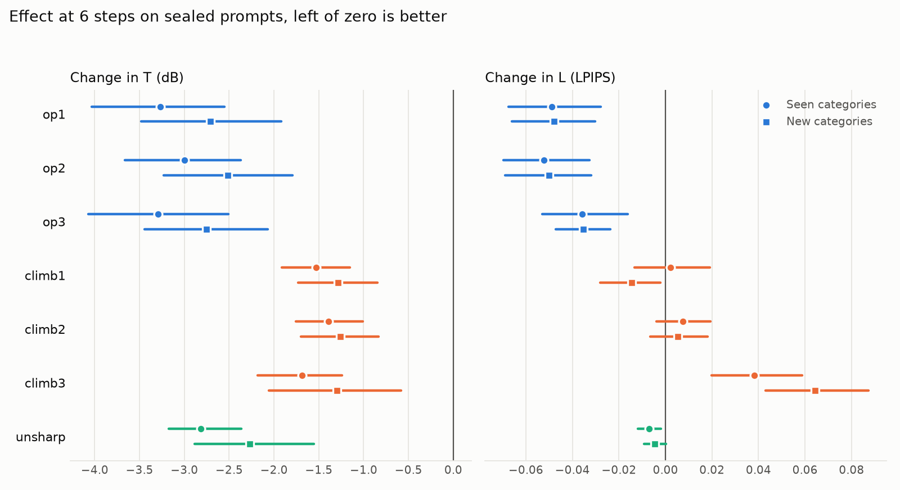
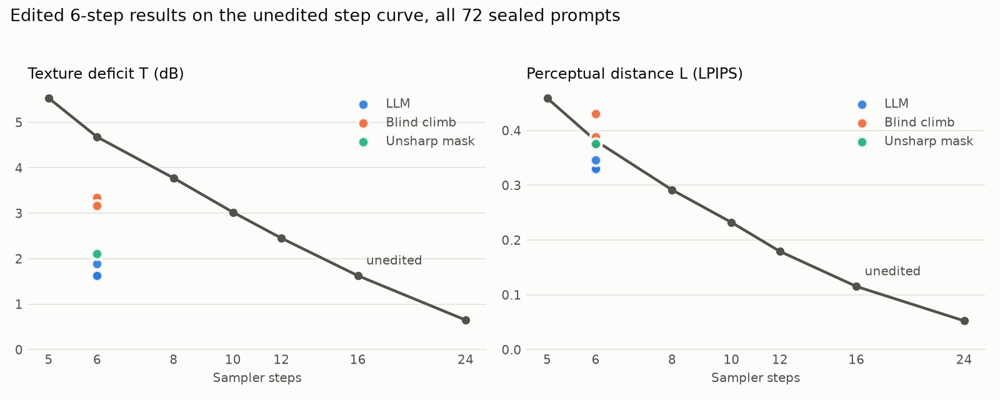
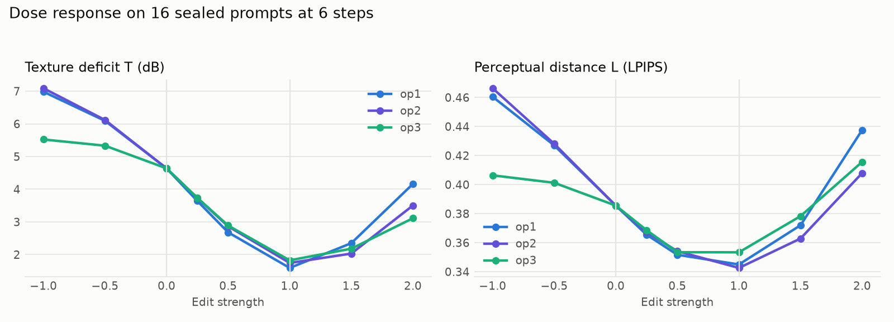

# Experiment 1: can an LLM edit denoiser weights?

This is the project's first experiment, kept as a record. The project has since moved to
the direction described in the [README](../README.md).

Can an LLM repair a few-step diffusion failure by editing the denoiser's weights
directly, without gradients? This repo tests that idea, adapted from
[Sparks of Weight-Space Programming](https://rikiyat.github.io/blog/weight-space-programming/).

> Bir diffusion modeli 50 yerine 5–8 adımda görüntü üretirken farklı promptlarda benzer
> bir hata ortaya çıkıyorsa, örneğin ince dokular sürekli kayboluyorsa, bir LLM bu hatayla
> ilişkili denoiser ağırlıklarını belirleyip gradyan kullanmadan düzenleyebilir mi? Bulunan
> tek bir düzenlemenin yeni promptlarda da işe yarayıp yaramadığını ve bu sayede daha az
> adımda benzer görüntü kalitesine ulaşılıp ulaşılamadığını test etmek istiyorum.

## Result

**Pre-registered verdict: Partial.** Three independent LLM agents each found a gradient-free
edit that restores lost texture on prompts and categories they never saw. It does not deliver
the same image quality in fewer steps, and the edit turns out not to need weight editing at all.

| Question | Answer | Evidence, 6 steps, 72 sealed prompts |
|---|---|---|
| Is the error consistent across prompts? | **Yes, on one schedule** | Energy is missing on 94-100% of prompts with DDIM trailing, at +4.4 to +4.9 dB. In the pilot, linspace DDIM and DPM++ showed excess energy instead |
| Can an LLM fix it without gradients? | **Yes, 3 of 3** | Texture deficit falls from about 4.7 to 1.5-2.0 dB, changing 0.13% of the weights |
| Does one edit work on new prompts? | **Yes** | It also works in unseen categories, slightly weaker: -2.5 to -2.8 dB against -3.0 to -3.3 dB |
| Does it reach 50-step-like quality in fewer steps? | **Texture statistics yes, the image no** | Texture matches 13.5-17 unedited steps. Perceptual distance matches only about 7 |
| Did it find the weights behind the error? | **Not in a meaningful sense** | The same correction in the sampling loop, with no weights changed, gives near-identical images |

Three more things to know before using these edits:

- **The edit damages slow sampling.** At 50 steps the edited model lands as far from the unedited
  50-step image (LPIPS 0.22-0.24) as unedited sampling does at about 10 steps.
- **It can invent structure.** In one of eight evenly spaced examples below, flat burlap grows
  large maze-like wrinkles that neither the baseline nor the reference has.
- **The fair framing is a sampler correction, not a repair.** Exploratory testing shows that a
  single gain number supplies most of the benefit.



*Evenly spaced sealed prompts, op1's edit. Columns: unedited 6 steps, edited 6 steps, unedited
50 steps, then the same three magnified. Row 1 shows the invented wrinkles. Row 4 shows that
composition stays wrong: the driftwood is still a pile of sticks.*

## Hypotheses

Scored mechanically by `wspd/report.py` against criteria fixed in
[`docs/PREREGISTRATION.md`](PREREGISTRATION.md). H1 applies to the unedited model, H6 is
scored per operator and against the climb median, and the rest are per operator on both splits.

| | Claim | op1 | op2 | op3 |
|---|---|---|---|---|
| H1 | The error is consistent across prompts | pass | pass | pass |
| H2 | Texture improves on sealed prompts | pass | pass | pass |
| H3 | Perceptual distance improves | pass | pass | pass |
| **H4** | **Edited 6 steps matches unedited 8+ on both T and LPIPS** | **fail** | **fail** | **fail** |
| H5 | Meaning is preserved (CLIP) | pass | pass | pass |
| H6 | Beats blind search, and beats random placement | pass | pass | pass |
| H7 | Dose response is causal | pass | pass | pass |

## Results by arm

T is the texture deficit in dB and L is LPIPS, both against the same-seed 50-step image. Lower is
better. Score is `T/T_base + L/L_base`, where 2.0 is the unedited model. Brackets are 95% paired
bootstrap intervals. "Seen" and "new" are the prompt categories.

| Arm | Weights changed | Score | Change in T, seen | Change in T, new | Change in L, seen | Change in L, new | Steps matched, T / L (seen) | Steps matched, T / L (new) |
|---|---:|---:|---|---|---|---|---|---|
| **op1** | 421,120 | **1.229** | -3.27 [-4.03, -2.56] | -2.71 [-3.48, -1.92] | -0.049 [-0.067, -0.028] | -0.048 [-0.066, -0.030] | 16.9 / 7.0 | 14.5 / 7.0 |
| **op2** | 421,120 | **1.272** | -3.00 [-3.67, -2.37] | -2.52 [-3.23, -1.79] | -0.052 [-0.070, -0.033] | -0.050 [-0.069, -0.032] | 15.4 / 7.1 | 13.5 / 7.0 |
| **op3** | 409,600 | **1.255** | -3.29 [-4.07, -2.51] | -2.76 [-3.44, -2.07] | -0.036 [-0.053, -0.016] | -0.035 [-0.047, -0.024] | 17.1 / 6.7 | 14.8 / 6.7 |
| Blind climb 1 | 49,418,208 | 1.683 | -1.53 [-1.91, -1.15] | -1.29 [-1.73, -0.85] | +0.002 [-0.013, +0.019] | -0.014 [-0.028, -0.002] | 9.8 / 6.0 | 8.5 / 6.3 |
| Blind climb 2 | 74,280,911 | 1.732 | -1.39 [-1.75, -1.01] | -1.26 [-1.70, -0.83] | +0.008 [-0.004, +0.019] | +0.005 [-0.007, +0.018] | 9.5 / 5.9 | 8.4 / 5.9 |
| Blind climb 3 | 46,428,124 | 1.808 | -1.69 [-2.19, -1.24] | -1.30 [-2.06, -0.58] | +0.038 [+0.020, +0.059] | +0.064 [+0.043, +0.087] | 10.2 / 5.5 | 8.5 / 5.2 |
| Unsharp mask | 0 | 1.436 | -2.81 [-3.17, -2.37] | -2.27 [-2.89, -1.55] | -0.007 [-0.012, -0.002] | -0.005 [-0.009, +0.000] | n/a | n/a |



- **An image filter nearly matches the LLM edits on T.** Recovering "energy" is cheap. What
  separates the LLM edits from the filter is LPIPS, where they are roughly 5 to 10 times stronger.
- **Location matters.** Scattering each edit's own values at random inside the same tensors scored
  1.98-2.02, which is no effect, against 1.28-1.31 for the real edits on the same 24 prompts.
  None of the 60 random draws came close.
- **Texture statistics really are restored.** SWD falls from 187 to 36-43 on seen categories and
  from 193 to 53-70 on new ones. Unedited 16-step sampling scores 74 and 67.
- **5 and 8 steps follow the same pattern.** T still improves strongly. LPIPS gains shrink at 8
  steps, and some of those intervals include zero.



### The edit has a real optimum

Strength 1 is close to the best point for all three operators, and reversing the edit makes things
worse. Overshoot sets in by strength 1.5.



## What the LLMs found

All three operators, working separately, converged on the same tensor. Each one remapped the
timestep the network perceives by refitting `time_embedding.linear_1` in closed form, leaving high
timesteps alone so composition steps keep their labels. op1 and op2 also scaled `conv_out` by about
0.99. Details, including what failed, are in each operator's report:
[op1](../results/edits/op1/report.md), [op2](../results/edits/op2/report.md), [op3](../results/edits/op3/report.md).

No operator reported finding this by spotting a pattern in the weight values. Each credits
architecture knowledge, activation probes, a Gaussian model of DDIM and 21-30 metered trials, and
the final constants were tuned by experiment. This is not the "reading weights natively" the
article describes.

## Exploratory: was weight editing needed?

This analysis was not pre-registered. It uses the operators' own constants, so nothing is selected
on test data. See [`scripts/sampler_equivalence.py`](../scripts/sampler_equivalence.py).

A gain on the noise prediction and a timestep relabel can both be applied in the sampling loop, so I
ran the same corrections there with no weights changed.

| 6 steps, 72 sealed prompts | T | L | SWD | Composition error | Pixel difference from the weight edit |
|---|---:|---:|---:|---:|---:|
| Unedited 6 steps | 4.68 | 0.381 | 192 | 20.28 | |
| Unedited 8 steps | 3.77 | 0.291 | 157 | 15.08 | |
| Unedited 16 steps | 1.63 | 0.115 | 73 | 6.29 | |
| op1, weight edit | 1.66 | 0.333 | 43 | 19.78 | |
| op1, same correction in the sampler | 1.66 | 0.333 | 43 | 19.89 | 0.69 / 255 |
| op3, weight edit | 1.62 | 0.346 | 52 | 20.21 | |
| op3, same correction in the sampler | 1.62 | 0.346 | 52 | 20.21 | 0.03 / 255 |
| `conv_out` x 0.9825, one number | 2.35 | 0.330 | 84 | 19.79 | |

For scale, op1's edit moves pixels 10.81/255 from the unedited image, so the sampler replica lands
within about 6% of that distance. Composition error is the RMS difference after a Gaussian blur with
sigma 16, on a 0-255 scale.

This changes how to read the result:

1. **The edits are sampler corrections compiled into weights.** They resemble two published,
   training-free methods: [Epsilon Scaling](https://arxiv.org/abs/2308.15321), which scales down the
   network output, and the [Time-Shift Sampler](https://arxiv.org/abs/2305.15583), which changes the
   timestep given to the network. I have read summaries of these papers, not the full texts. The
   operators may have known of them from training.
2. **Compiling it into weights is worse.** A static edit cannot know the step count, which is what
   causes the 50-step damage. A sampler-level correction can simply switch off at high step counts.
3. **One number does most of the work.** That gain gives 77% of op1's T improvement and the best
   LPIPS of any arm. So beating the blind climb is a low bar: a one-dimensional line search on
   `conv_out` would probably compete, though I did not run one.
4. **Composition is what extra steps buy, and the edits barely touch it.** They reduce composition
   error by at most 0.5, while going from 6 to 16 steps reduces it by 14. This is why H4 failed.
   A caveat: LPIPS against a same-seed image penalizes a plausible texture that merely differs, so it
   may understate the perceived improvement.

The article's own caution fits: editing weights could remove an obstacle hiding an ability, but it
could not add an ability the model lacked. Here the texture was never missing from the model, only
from this large-step trajectory.

## Limits

- **One small model and one sampler.** The premise itself fails on the other two schedules tested
  (8 prompts), and the edits were not tested there.
- **All operators are the same model.** Three agents show repeatability, not a fact about LLMs in
  general. Their edits share a family and may share a blind spot.
- **Reference metrics stand in for quality.** 72 images is far too few for FID.
- **The dev split was reused.** Operators tuned on all 24 dev prompts, though every number above comes
  from sealed prompts.
- **The blind control is deliberately simple.** It scales whole tensors at random, and a better
  optimizer would do better.

### Deviations and process notes

- The pre-registration was amended once, before any edit had been scored on any split, to resolve a
  contradiction about what a matching filter implies. Both hashes are in
  [`results/preregistration.sha256`](../results/preregistration.sha256).
- op1 and op3 evaluated the small time-embedding MLP on CPU with synthetic timesteps, outside the
  budget. No images, UNet or VAE were involved. Both disclosed this; it is a grey area under rule 2.
- Operators read parts of `src/`, which the brief allowed. A comment in `config.py` hinted that energy
  is lost on every prompt. That comment is now neutral. op2 also read 5 lines of `supervisor.py` and op3
  searched it for two embedding flags.
- op3 ran two trials in parallel and overwrote one contact sheet, though its metrics survived. That race
  in the harness is fixed.
- The audit scanned all operator tool calls and found no gradient calls, no model loading outside the
  metered commands and no reads of sealed data. Budgets used were 40, 37 and 38 of 40, and all sealed
  edits reproduce exactly from their scripts. A local machine cannot truly seal files from an agent with
  shell access, so this is an audit rather than a guarantee.

## What came next

The follow-ups suggested by this experiment were piloted on 10 November 2026:

- **Edits a sampler cannot express.** Giving each resolution level of the UNet its own
  timestep gained 0.04 dB over one shifted timestep. Negative.
- **Blind search in a sensible space.** A compass search over four sampler parameters, with
  the agents' budget, scored 1.283 against 1.229-1.272 for the agents.
- **Composition error.** It is decided entirely above t=666. A front-loaded schedule cuts
  it by 28% at equal cost, but perceptual distance does not move.

Details are in [`research_ideas/pilots.md`](../research_ideas/pilots.md). These results led to
the current direction in the [README](../README.md).

## Reproduce

Tested on an Apple M4 Pro with 24 GB. The pipeline runs at batch size 1, because self-attention
at 64x64 latents allocates about 8 GiB per call at batch 8. Output is byte-identical across batch sizes
and reruns on MPS. The blind climbs, sealed baselines and scoring of every arm took about 3.5 hours.

```bash
.venv/bin/wsp-sup pilot      # compare samplers on dev
.venv/bin/wsp-sup prepare    # dev references and free probes

# Give docs/OPERATOR_BRIEF.md to each LLM operator, as runs op1, op2 and op3.
# Each one works through `wsp` and finishes with `wsp submit`.

scripts/evaluate_all.sh      # blind climbs, sealed scoring, nulls, filter, report
.venv/bin/python scripts/sampler_equivalence.py
.venv/bin/python scripts/make_sheet.py op1
```

The model is `segmind/tiny-sd` at a pinned revision, with 323M UNet weights against 860M for SD 1.5. It
ships pickled `.bin` weights, which load through PyTorch's `weights_only` path.

## Files

```
docs/OPERATOR_BRIEF.md       The full brief each LLM received
docs/PREREGISTRATION.md      Hypotheses and success criteria, fixed before scoring
data/prompts_pool.json       96 prompts in 12 categories
src/wspd/cli.py              `wsp`: what an operator may do, on dev only, with a budget
src/wspd/supervisor.py       `wsp-sup`: references, sealed scoring and controls
src/wspd/edits.py            Edit format, gradient lint and validation
src/wspd/report.py           Scores hypotheses and draws figures
results/                     Scores, figures, and each operator's edit, ledger and report
```
